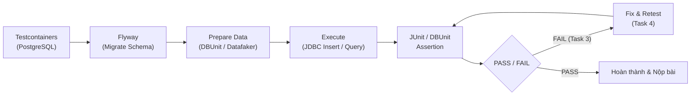

# Generate, Test & Fix – Database Testing Challenge

Bài thực hành cá nhân dành cho sinh viên với kiến thức cơ bản về Java, SQL và kiểm thử phần mềm.

- **Thời gian hoàn thành dự kiến:** 10–15 phút (không tính thời gian cài đặt môi trường).
- **Hình thức:** Làm việc cá nhân.

## 1. Bối cảnh & Mục tiêu học tập

Bạn sẽ kiểm thử tầng cơ sở dữ liệu (database layer) cho hệ thống đăng ký người dùng với bảng `users`:

| Cột | Kiểu dữ liệu | Yêu cầu nghiệp vụ |
|---|---|---|
| `id` | Integer | Khóa chính tự động tăng |
| `username` | `VARCHAR(20)` | `NOT NULL`, độ dài từ 3 đến 20 ký tự |
| `email` | `VARCHAR(100)` | `NOT NULL`, `UNIQUE` |
| `age` | Integer | `NOT NULL`, từ 18 đến 60 (bao gồm cả hai đầu mút) |

Sau bài thực hành, bạn sẽ nắm được:
- Sinh dữ liệu kiểm thử tái lập (reproducible test data) với **Datafaker** và fixed seed.
- Thiết kế test case bằng kỹ thuật **Boundary Value Analysis (BVA)** với **JUnit 5** parameterized tests.
- Chuẩn bị dữ liệu và đối chiếu **Expected vs. Actual** ở mức bảng cơ sở dữ liệu bằng **DBUnit**.
- Đảm bảo **test isolation** với **Testcontainers** (PostgreSQL thật) và **Flyway**.
- Quy trình phát hiện lỗi (bug hunting), sửa lỗi schema và chạy lại kiểm thử hồi quy (regression testing).

## 2. Công nghệ sử dụng

- **Java:** JDK 25+ (`maven.compiler.release=25`)
- **Build tool:** Maven & Maven Wrapper (`./mvnw`, `.\mvnw.cmd`)
- **Testing:** JUnit 5, DBUnit, Datafaker
- **Database & Migration:** PostgreSQL (chạy qua Testcontainers), Flyway, JDBC

## 3. Yêu cầu môi trường & Quick Start

Trước khi bắt đầu, bạn chỉ cần cài đặt thủ công **JDK 25+** và **Docker Desktop** (hoặc Docker engine tương thích). Không cần cài đặt thủ công Maven hay PostgreSQL.

Xem hướng dẫn chi tiết tại [docs/SETUP.md](docs/SETUP.md).

Kiểm tra nhanh môi trường bằng `SmokeTest`:

```bash
./mvnw -Dtest=SmokeTest test
```

> Trên Windows PowerShell, thay `./mvnw` bằng `.\mvnw.cmd`.

Nếu `SmokeTest` trả về `BUILD SUCCESS`, môi trường của bạn đã sẵn sàng!

## 4. Quy trình thực hiện (Workflow)



## 5. Tóm tắt 4 nhiệm vụ & Các file cần chỉnh sửa

Bạn **chỉ** chỉnh sửa 3 file sau trong toàn bộ bài thực hành:
1. [DataGenerationTest.java](src/test/java/com/example/dbtesting/DataGenerationTest.java)
2. [UserConstraintTest.java](src/test/java/com/example/dbtesting/UserConstraintTest.java)
3. [V1__create_users_table.sql](src/main/resources/db/migration/V1__create_users_table.sql)

| Task | Nội dung | Thời gian | Lệnh chạy kiểm tra | Kết quả mong đợi |
|---|---|---|---|---|
| **Task 1** | Hoàn thành `TODO 1.1` và `TODO 1.2` để sinh 10 user hợp lệ bằng Datafaker | 3 phút | `./mvnw -Dtest=DataGenerationTest test` | `PASS` |
| **Task 2** | Hoàn thành `TODO 2.1` và `TODO 2.2` bằng kỹ thuật BVA trong `@CsvSource` | 4 phút | `./mvnw -Dtest=UserConstraintTest test` | Phát hiện **1 lỗi chủ đích** (`FAIL`) |
| **Task 3** | Chạy toàn bộ test, phân tích Expected vs. Actual, tìm nguyên nhân trong migration và chụp `before_fix.png` | 2 phút | `./mvnw test` | `Failures: 1, Errors: 0, Skipped: 0` |
| **Task 4** | Sửa lỗi ràng buộc trong `V1__create_users_table.sql`, chạy lại toàn bộ test và chụp `after_fix.png` | 3 phút | `./mvnw test` | Tất cả `PASS` (`Failures: 0, Errors: 0, Skipped: 0`) |

**Tiến trình kết quả chuẩn:**
`Môi trường sẵn sàng (SmokeTest PASS)` → `Task 1 PASS` → `Task 2 có đúng 1 lỗi chủ đích` → `Task 4 tất cả PASS`.

Hướng dẫn từng bước chi tiết xem tại [docs/EXERCISE.md](docs/EXERCISE.md).

## 6. Nộp bài (Submission)

Thư mục mẫu nằm tại `submit/MSSV/`. Sau khi hoàn thành bài thực hành:
1. Đổi tên thư mục `MSSV` thành mã số sinh viên của bạn.
2. Chuẩn bị **đúng 6 file** trong thư mục `<MSSV>/`:
   - `DataGenerationTest.java` (copy từ `src/test/java/com/example/dbtesting/`)
   - `UserConstraintTest.java` (copy từ `src/test/java/com/example/dbtesting/`)
   - `V1__create_users_table.sql` (copy từ `src/main/resources/db/migration/`)
   - `before_fix.png` (ảnh chụp màn hình kết quả FAIL ở Task 3)
   - `after_fix.png` (ảnh chụp màn hình kết quả PASS toàn bộ ở Task 4)
   - `REPORT.md` (điền đầy đủ thông tin và câu trả lời)
3. Nén thư mục `<MSSV>/` thành `<MSSV>.zip` để nộp. **Không** nộp toàn bộ project, `target/`, hay thư viện phụ thuộc.

## 7. Tài liệu tham khảo

- [docs/SETUP.md](docs/SETUP.md) – Hướng dẫn cài đặt môi trường (macOS / Windows / Linux).
- [docs/EXERCISE.md](docs/EXERCISE.md) – Hướng dẫn chi tiết 4 tasks, API tham khảo, gợi ý và câu hỏi thảo luận.
- [docs/TROUBLESHOOTING.md](docs/TROUBLESHOOTING.md) – Xử lý các lỗi thường gặp về Java, Docker, Maven, Flyway, JDBC và DBUnit.
