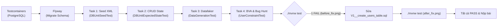

# Generate, Test & Fix – Database Testing Challenge

Bài thực hành cá nhân dành cho sinh viên với kiến thức cơ bản về Java, SQL và kiểm thử phần mềm.

- **Thời gian hoàn thành dự kiến:** 15–20 phút (không tính thời gian cài đặt môi trường và nộp bài).
- **Hình thức:** Làm việc cá nhân.

## 1. Bối cảnh & Mục tiêu học tập

Bạn sẽ kiểm thử tầng cơ sở dữ liệu (database layer) cho hệ thống đăng ký người dùng với bảng `users`:

| Cột | Kiểu dữ liệu | Yêu cầu nghiệp vụ |
|---|---|---|
| `id` | Integer | Khóa chính tự động tăng |
| `username` | `VARCHAR(20)` | `NOT NULL`, độ dài từ 3 đến 20 ký tự |
| `email` | `VARCHAR(100)` | `NOT NULL`, `UNIQUE` |
| `age` | Integer | `NOT NULL`, từ 18 đến 60 (bao gồm cả hai đầu mút) |

Lộ trình học tập qua 4 nhiệm vụ được thiết kế theo tiến trình từ thủ công đến tự động:
1. **Chuẩn bị dữ liệu thủ công bằng DBUnit XML:** Tự viết Flat XML Dataset (`initial-users.xml`) để nạp dữ liệu khởi tạo.
2. **Kiểm thử trạng thái CRUD với Expected vs. Actual XML:** Đọc mã CRUD, dự đoán trạng thái cuối cùng của cơ sở dữ liệu (`expected-users.xml`) và đối chiếu tự động bằng DBUnit.
3. **Sinh dữ liệu tự động với Datafaker & DBUnit in-memory:** Sinh dữ liệu kiểm thử tái lập (reproducible test data) bằng **Datafaker** (fixed seed) và dựng bảng kỳ vọng trong bộ nhớ.
4. **Kiểm thử giá trị biên & Săn lỗi (BVA, Bug Hunting & Fix):** Áp dụng **Boundary Value Analysis (BVA)** với **JUnit 5**, phát hiện lỗi schema chủ đích, sửa file migration và kiểm thử hồi quy.

> **Phân biệt rõ vai trò:** Bạn chuẩn bị dữ liệu đầu vào/kỳ vọng (file XML, giá trị BVA, biểu thức Datafaker), còn toàn bộ quá trình khởi tạo PostgreSQL (**Testcontainers**), chạy migration (**Flyway**), nạp dữ liệu (`CLEAN_INSERT`), thực thi truy vấn và đối chiếu (`Assertion.assertEquals`) được thực hiện tự động bởi bộ test.

## 2. Công nghệ sử dụng

- **Java:** JDK 25+ (`maven.compiler.release=25`)
- **Build tool:** Maven & Maven Wrapper (`./mvnw`, `.\mvnw.cmd`)
- **Testing:** JUnit 5, DBUnit, Datafaker
- **Database & Migration:** PostgreSQL (chạy qua Testcontainers), Flyway, JDBC

## 3. Yêu cầu môi trường & Quick Start

Trước khi bắt đầu, bạn chỉ cần cài đặt thủ công **JDK 25+** và **Docker Desktop** (hoặc Docker engine tương thích). Không cần cài đặt thủ công Maven hay PostgreSQL.

Xem hướng dẫn chi tiết tại [docs/SETUP.md](docs/SETUP.md).

Kiểm tra nhanh môi trường bằng `SmokeTest`:

```bash
./mvnw -Dtest=SmokeTest test
```

> Trên Windows PowerShell, thay `./mvnw` bằng `.\mvnw.cmd`.

Nếu `SmokeTest` trả về `BUILD SUCCESS`, môi trường của bạn đã sẵn sàng!

## 4. Quy trình thực hiện (Workflow)



## 5. Tóm tắt 4 nhiệm vụ & Các file cần chỉnh sửa

Bạn **chỉ** chỉnh sửa **5 file** sau trong toàn bộ bài thực hành:
1. [initial-users.xml](src/test/resources/datasets/initial-users.xml)
2. [expected-users.xml](src/test/resources/datasets/expected-users.xml)
3. [DataGenerationTest.java](src/test/java/com/example/dbtesting/DataGenerationTest.java)
4. [UserConstraintTest.java](src/test/java/com/example/dbtesting/UserConstraintTest.java)
5. [V1__create_users_table.sql](src/main/resources/db/migration/V1__create_users_table.sql)

| Task | Nội dung | Thời gian | Lệnh chạy kiểm tra | Kết quả mong đợi |
|---|---|---|---|---|
| **Task 1** | Hoàn thành `initial-users.xml` (`TODO 1.1`) theo định dạng DBUnit Flat XML | 3 phút | `./mvnw -Dtest=DBUnitSeedTest test` | `PASS` (1/1) |
| **Task 2** | Đọc CRUD trong `DBUnitExpectedStateTest`, dự đoán trạng thái cuối vào `expected-users.xml` (`TODO 2.1`) | 4 phút | `./mvnw -Dtest=DBUnitExpectedStateTest test` | `PASS` (1/1) |
| **Task 3** | Hoàn thành `TODO 3.1` và `TODO 3.2` trong `DataGenerationTest` bằng Datafaker | 4 phút | `./mvnw -Dtest=DataGenerationTest test` | `PASS` (1/1) |
| **Task 4** | Hoàn thành `TODO 4.1` và `TODO 4.2` (BVA), chạy toàn bộ suite để chụp `before_fix.png`, sửa `V1__create_users_table.sql`, chạy lại và chụp `after_fix.png` | 6 phút | `./mvnw test` | Trước sửa: `Failures: 1`<br/>Sau sửa: `Failures: 0, Errors: 0, Skipped: 0` (13/13) |

**Tiến trình kết quả chuẩn:**
`SmokeTest PASS` → `Task 1 PASS` → `Task 2 PASS` → `Task 3 PASS` → `Task 4 có đúng 1 lỗi chủ đích (before_fix.png)` → `Sửa SQL & tất cả 13 tests PASS (after_fix.png)`.

Hướng dẫn từng bước chi tiết xem tại [docs/EXERCISE.md](docs/EXERCISE.md).

## 6. Nộp bài (Submission)

Thư mục mẫu nằm tại `submit/MSSV/`. Sau khi hoàn thành bài thực hành:
1. Đổi tên thư mục `MSSV` thành mã số sinh viên của bạn.
2. Chuẩn bị **đúng 8 file** trong thư mục `<MSSV>/`:
   - `initial-users.xml` (copy từ `src/test/resources/datasets/`)
   - `expected-users.xml` (copy từ `src/test/resources/datasets/`)
   - `DataGenerationTest.java` (copy từ `src/test/java/com/example/dbtesting/`)
   - `UserConstraintTest.java` (copy từ `src/test/java/com/example/dbtesting/`)
   - `V1__create_users_table.sql` (copy từ `src/main/resources/db/migration/`)
   - `before_fix.png` (ảnh chụp màn hình kết quả FAIL ở Task 4)
   - `after_fix.png` (ảnh chụp màn hình kết quả PASS toàn bộ ở Task 4)
   - `REPORT.md` (điền đầy đủ thông tin và câu trả lời)
3. Nén thư mục `<MSSV>/` thành `<MSSV>.zip` để nộp. **Không** nộp toàn bộ project, `target/`, hay thư viện phụ thuộc.

## 7. Tài liệu tham khảo

- [docs/SETUP.md](docs/SETUP.md) – Hướng dẫn cài đặt môi trường (macOS / Windows / Linux).
- [docs/EXERCISE.md](docs/EXERCISE.md) – Hướng dẫn chi tiết 4 tasks, ví dụ Flat XML, API tham khảo và gợi ý.
- [docs/TROUBLESHOOTING.md](docs/TROUBLESHOOTING.md) – Xử lý các lỗi thường gặp về Java, Docker, Maven, Flyway, JDBC và DBUnit.
